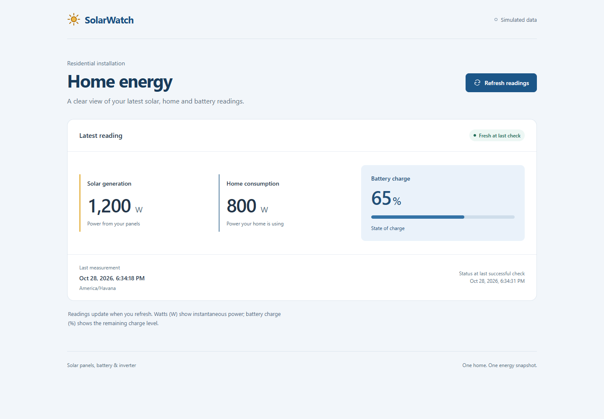

# SolarWatch

An open-source residential solar energy monitoring and analytics platform built with ASP.NET Core and React.

**Status: Early Development.** The first Full Stack feature connects PostgreSQL, the .NET API, and React to display one simulated installation's latest reading. The owner has approved this delivery; integration of [PR #5](https://github.com/libanlsilva/solarwatch/pull/5) completes Phase 2. The full MVP is not complete.

## Goals and motivation

SolarWatch makes solar generation, household energy consumption, and battery charge easier to understand. It is developed incrementally as a Full Stack portfolio project, with small reviewed deliveries, explicit requirements, meaningful tests, and reproducible local setup.

## Implemented in this delivery

- One residential demo installation with panels, a battery, and an inverter, using simulated readings.
- EF Core migration and PostgreSQL persistence for reading snapshots.
- A latest-reading API returning generation (W), consumption (W), battery state of charge (%), measurement time, and server reference time (`asOf`).
- A responsive React view with manual refresh, loading, empty, error/retry, retained-data warnings, and stale-data states.
- Freshness based on `asOf`, with readings older than five minutes labeled stale at the last successful check.
- Development-only migration, current-time or controlled-time seed, and explicitly confirmed demo-clear commands.
- Meaningful backend unit tests, real PostgreSQL integration tests, frontend unit tests, and Playwright browser tests, executed in CI.

The generated weather endpoint and empty template classes/tests have been removed. The simulator directory is reserved; the development seed is not a continuous simulator.



Captured from the local PostgreSQL/API/React demonstration; values and timestamps are simulated example data from that session.

## Planned functionality

Later MVP deliveries add continuous simulated ingestion and 24-hour history charts. Hardware integration, authentication, multiple users/installations, SignalR, alerts, forecasts, accumulated-energy calculations, and production deployment are outside this first slice.

Instantaneous power is measured in **W**. Accumulated energy is measured in **Wh/kWh**; 1 kWh = 1,000 Wh. This delivery does not calculate energy totals from power samples or convert battery charge percentage into stored energy.

## Technology stack

| Area | Technology | State |
| --- | --- | --- |
| Backend | ASP.NET Core 10, C# | Latest-reading API and development commands |
| Persistence | EF Core, Npgsql, PostgreSQL 17 | Migration and real persistence |
| Frontend | React, TypeScript, Vite | Responsive latest-reading view |
| UI/charts | Plain CSS for this slice; Tailwind CSS, shadcn/ui, Recharts planned | No dashboard component system or charts yet |
| Testing | xUnit, Node.js test runner, Playwright | Unit, PostgreSQL integration, and Chromium E2E tests |
| Infrastructure | Docker Compose, GitHub Actions | PostgreSQL service; backend, frontend, and Full Stack E2E workflows |
| Real-time updates | SignalR | Later enhancement; current refresh is manual |

## Architecture and structure

```text
React → GET /api/readings/latest → Application query → PostgreSQL store → PostgreSQL

Api → Application, Infrastructure
Application → Domain
Infrastructure → Application, Domain
UnitTests → Domain, Application
IntegrationTests → Api (including its real PostgreSQL infrastructure)
```

The Domain owns reading validation. Application defines the query and a single purpose-built storage contract. Infrastructure supplies EF Core and its implementation; Api composes the services. There is no generic repository framework or messaging layer.

```text
solarwatch/
├── .github/workflows/           # Backend, frontend, and Full Stack E2E CI
├── backend/
│   ├── src/
│   │   ├── SolarWatch.slnx
│   │   ├── SolarWatch.Api/      # Endpoint, development commands, Dockerfile
│   │   ├── SolarWatch.Application/
│   │   ├── SolarWatch.Domain/
│   │   └── SolarWatch.Infrastructure/ # DbContext, store, migrations
│   └── tests/
│       ├── SolarWatch.UnitTests/
│       └── SolarWatch.IntegrationTests/
├── frontend/
│   ├── src/
│   ├── tests/unit/
│   ├── tests/e2e/
│   └── playwright.config.ts
├── docs/
│   ├── DEVELOPMENT_PLAN.md
│   ├── requirements/MVP.md
│   ├── architecture/latest-reading.md
│   └── screenshots/
├── simulator/                   # Reserved for a later delivery
├── docker-compose.yml
├── dotnet-tools.json
├── .env.example
├── CONTRIBUTING.md
└── LICENSE
```

See the [API contract and decisions](docs/architecture/latest-reading.md), [approved MVP](docs/requirements/MVP.md), and [development plan](docs/DEVELOPMENT_PLAN.md).

## Local setup

Prerequisites: .NET 10 SDK, Node.js 24 with npm, Git, Docker with Linux containers, and access to NuGet/npm. Compose runs PostgreSQL only; the API and frontend run on the host.

### 1. Start PostgreSQL and configure the API

Copy `.env.example` to `.env`, set a non-empty local `POSTGRES_PASSWORD`, and keep that populated file untracked. The default database port is 5434, bound to loopback. Compose preserves data in a named volume.

```sh
docker compose up -d --wait postgres
```

Compose reads `.env`; ASP.NET Core does not automatically read it. In PowerShell, from the repository root, load the same local values into the current session:

```powershell
$localConfig = Get-Content .env | ConvertFrom-StringData
$env:ConnectionStrings__SolarWatch = "Host=127.0.0.1;Port=$($localConfig.POSTGRES_PORT);Database=solarwatch;Username=solarwatch;Password=$($localConfig.POSTGRES_PASSWORD)"
$env:ASPNETCORE_ENVIRONMENT = 'Development'
```

For Bash, set `ConnectionStrings__SolarWatch` to the equivalent local connection string and `ASPNETCORE_ENVIRONMENT=Development` using your local secret values. ASP.NET Core user secrets are also supported. Never commit populated connection strings or print credentials in logs.

### 2. Build, migrate, seed, and run the API

```sh
dotnet restore backend/src/SolarWatch.slnx
dotnet build backend/src/SolarWatch.slnx --configuration Release --no-restore
dotnet run --project backend/src/SolarWatch.Api --configuration Release --no-build --no-launch-profile -- migrate
dotnet run --project backend/src/SolarWatch.Api --configuration Release --no-build --no-launch-profile -- seed-demo
dotnet run --project backend/src/SolarWatch.Api --configuration Release --no-build --launch-profile http
```

The API runs at `http://localhost:5171`. Development OpenAPI JSON is at `/openapi/v1.json`; there is no Swagger UI. The app does not automatically migrate or seed during normal startup.

`seed-demo` inserts 1,200 W generation, 800 W consumption, and 65% charge at the **current server UTC time**, allowing a fresh demo. To prepare a repeatable historical/stale example:

```sh
dotnet run --project backend/src/SolarWatch.Api --configuration Release --no-build --no-launch-profile -- seed-demo --measured-at 2026-10-01T12:00:00Z
```

Timestamps need an explicit UTC/offset designation and cannot be in the future. Repeating the same controlled timestamp does not duplicate it. An older seed does not supersede a newer measurement; use an empty development database for a controlled stale-only demonstration.

To demonstrate an empty state, `clear-demo --confirm` deletes this installation's readings from the configured database. It requires explicit confirmation and the Development environment. Migration/seeding/clearing commands all refuse to run outside Development. Do not point these development commands at valuable data.

### 3. Run React

In a second terminal:

```sh
cd frontend
npm ci
npm run dev
```

Open the address printed by Vite, normally `http://localhost:5173`. Its `/api` proxy defaults to `http://127.0.0.1:5171`. Set `SOLARWATCH_API_URL` before starting Vite if the API uses another address. The same proxy works with `npm run preview` after a production build.

Readings refresh on load and on request. The freshness badge reports the state at the last successful server check, not a continuously updated or browser-clock-based status. Display times use the browser's identified local zone.

## Validation

### Backend unit and real PostgreSQL integration tests

Integration tests require `SOLARWATCH_TEST_CONNECTION` and refuse a database name that does not end in `_tests`. They migrate and clear the dedicated test database; they never silently skip missing infrastructure. The configured PostgreSQL role must be able to create the dedicated database if it does not exist.

In the PowerShell session configured above:

```powershell
$env:SOLARWATCH_TEST_CONNECTION = $env:ConnectionStrings__SolarWatch.Replace('Database=solarwatch;', 'Database=solarwatch_tests;')
dotnet test backend/src/SolarWatch.slnx --configuration Release --no-build --no-restore
```

To run only unit tests without PostgreSQL, target `backend/tests/SolarWatch.UnitTests` explicitly. The solution command intentionally includes the database tests.

### Frontend and browser tests

```sh
cd frontend
npm ci
npm run lint
npm run build
npm run test:unit
npx playwright install --no-shell chromium
```

Before `npm run test:e2e`, set `SOLARWATCH_E2E_CONNECTION` to a dedicated database ending in `_e2e`. In PowerShell, using the earlier local API configuration:

```powershell
$env:SOLARWATCH_E2E_CONNECTION = $env:ConnectionStrings__SolarWatch.Replace('Database=solarwatch;', 'Database=solarwatch_e2e;')
npm run test:e2e
```

Build the Release API first. Playwright launches its own API on port 5181 and Vite preview on port 4181; those ports must be free. It migrates the E2E database and clears its demo readings before each test. Success scenarios use the real API/database; network interruption/delay is injected only for failure/loading checks. Browser clocks are deliberately shifted in freshness tests.

GitHub Actions runs backend tests against PostgreSQL, frontend lint/build/unit tests, and the full browser suite in a separate PostgreSQL-backed job. CI uses trust authentication only for disposable test services; local Compose requires a password. Browser failure traces are uploaded for diagnosis.

## Development roadmap

0. **Foundation complete:** initial structure and CI.
1. **Product definition complete:** approved residential MVP integrated through PR #3.
2. **Persisted latest reading approved; complete upon PR #5 integration:** PostgreSQL → API → React, development commands, state handling, and tests.
3. **Simulated ingestion next:** small deliveries for generated readings submitted through the API, ingestion validation/duplicate handling, then continuous simulation and reproducible history seeding.
4. **History and charts planned:** last 24 hours with correct units and gaps.
5. **Local MVP release planned:** full acceptance evidence, complete local orchestration, and release notes.

Before the complete dashboard UI is developed, a separate design step will define a visual prototype and a small reusable design system. The intended direction is a modern energy-monitoring dashboard, preferably dark, with metric cards, charts, and navigation. Tailwind CSS and shadcn/ui will be considered when justified. The current functional view is retained for this delivery.

## Current limitations

This is a local, unauthenticated demo. There is no ingestion endpoint, continuous simulator, 24-hour query/chart, energy integration, real hardware, or public deployment. Vite's proxy supports development/preview; production static hosting would require an appropriate API routing/deployment configuration. The existing API Dockerfile is retained, but this delivery validates the Compose database and host-run services, not complete app container orchestration.

## Contributing and license

Follow [CONTRIBUTING.md](CONTRIBUTING.md) for issues, focused branches, validation, and PR review. Each approved PR is integrated with squash, producing one commit on `main`. SolarWatch is licensed under the [MIT License](LICENSE).
