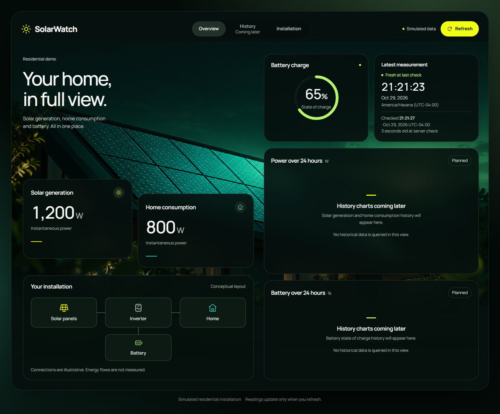

# SolarWatch

An open-source residential solar energy monitoring and analytics platform built with ASP.NET Core and React.

**Status: Early Development.** Phase 2 completed through [PR #5](https://github.com/libanlsilva/solarwatch/pull/5): PostgreSQL → .NET API → React displays one simulated installation's latest reading. **Phase 3 is complete:** finite HTTP simulation through [PR #7](https://github.com/libanlsilva/solarwatch/pull/7) / [Issue #6](https://github.com/libanlsilva/solarwatch/issues/6), continuous simulation through [PR #9](https://github.com/libanlsilva/solarwatch/pull/9) / [Issue #8](https://github.com/libanlsilva/solarwatch/issues/8), and full reproducible 24-hour preparation through reviewed integration of [PR #11](https://github.com/libanlsilva/solarwatch/pull/11) / [Issue #10](https://github.com/libanlsilva/solarwatch/issues/10). **Phase 4 is complete with the reviewed squash integration of [PR #13](https://github.com/libanlsilva/solarwatch/pull/13):** the owner definitively approved the four Overview/History desktop/mobile prototypes, all seven interface states, the reusable system and the publication package. The [design handoff](docs/design/README.md) remains the reference for future implementation. **Phase 5 is in progress:** [Issue #14](https://github.com/libanlsilva/solarwatch/issues/14) implements the approved responsive Overview with real latest-reading data; this first delivery awaits personal PR review and integration. **The MVP is not complete:** historical queries/charts and later release work remain unfinished.

## Goals and motivation

SolarWatch makes solar generation, household energy consumption, and battery charge easier to understand. It is developed incrementally as a Full Stack portfolio project, with small reviewed deliveries, explicit requirements, meaningful tests, and reproducible local setup.

## Implemented in this delivery

- One residential demo installation with panels, a battery, and an inverter, using simulated readings.
- EF Core migration and PostgreSQL persistence for reading snapshots.
- A latest-reading API returning generation (W), consumption (W), battery state of charge (%), measurement time, and server reference time (`asOf`).
- The approved desktop/mobile React Overview: solar photograph, asymmetric metric cards, battery gauge, local measurement/check times, conceptual installation and compact responsive navigation.
- Manual refresh with loading skeletons, empty, error/retry, refreshing, retained-data and stale-data states; single-flight requests and cancellation protect against obsolete responses.
- Working Overview/Installation anchors; History is visibly coming later. Historical card regions explicitly identify unavailable functionality and draw no illustrative charts.
- Freshness based on `asOf`, with readings older than five minutes labeled stale at the last successful check.
- Development-only migration, current-time or controlled-time seed, and explicitly confirmed demo-clear commands.
- A local Development-only ingestion endpoint with field validation and PostgreSQL-enforced duplicate conflicts, including concurrent requests.
- A finite .NET HTTP simulator with reproducible seed/timestamps, server-based current time, bounded batches, and explicit acceptance/rejection/error reporting.
- Optional continuous execution with an immediate reading, 60-second cadence, fresh server `asOf` per sample, and controlled Ctrl+C shutdown.
- A separate bounded `--history-24h` mode submitting exactly 1,441 reproducible minute samples through the existing API, with explicit conflicts and partial/uncertain-run reporting.
- Meaningful backend unit tests, real PostgreSQL integration tests, frontend unit tests, and Playwright browser tests, executed in CI.

The generated weather endpoint and empty template classes/tests have been removed. Finite simulation remains the default; the separate development seed remains available.



[Mobile initial view](docs/screenshots/overview-mobile.png) · [Complete mobile view](docs/screenshots/overview-mobile-full.png)

Captured from the implemented production frontend preview connected to the real local API and disposable PostgreSQL E2E database. Readings are simulated but persisted/queryable, not frontend fixtures. See the [implementation and visual comparison](docs/architecture/overview-ui.md) for scope, checks and remaining differences.

## Planned functionality

The approved dashboard prototypes guide Phase 5 in small reviewed deliveries: first the shared responsive shell and Overview using the existing latest-reading API, then historical queries and real-data charts. Implementation requires approval of each delivery issue. Hardware integration, authentication, multiple users/installations, SignalR, alerts, forecasts, accumulated-energy calculations, and production deployment remain outside this MVP.

Instantaneous power is measured in **W**. Accumulated energy is measured in **Wh/kWh**; 1 kWh = 1,000 Wh. This delivery does not calculate energy totals from power samples or convert battery charge percentage into stored energy.

## Technology stack

| Area | Technology | State |
| --- | --- | --- |
| Backend | ASP.NET Core 10, C# | Latest-reading API, local ingestion, development commands, and .NET simulator |
| Persistence | EF Core, Npgsql, PostgreSQL 17 | Migration and real persistence |
| Frontend | React, TypeScript, Vite | Approved responsive Overview connected to Latest Reading |
| UI/charts | Plain CSS Overview; Tailwind CSS and selective shadcn/ui evaluated, Recharts recommended for later charts | No UI/chart packages installed; historical regions explicitly unavailable |
| Testing | xUnit, Node.js test runner, Playwright | Unit, PostgreSQL integration, and Chromium E2E tests |
| Infrastructure | Docker Compose, GitHub Actions | PostgreSQL service; backend, frontend, and Full Stack E2E workflows |
| Real-time updates | SignalR | Later enhancement; current refresh is manual |

## Architecture and structure

```text
React → GET /api/readings/latest → Application query → PostgreSQL store → PostgreSQL
Simulator → local POST /api/readings → Application validation → PostgreSQL insert

Api → Application, Infrastructure
Application → Domain
Infrastructure → Application, Domain
UnitTests → Domain, Application
UnitTests → Simulator (for generation and HTTP-runner tests)
Simulator → Application (shared contracts), Domain transitively
IntegrationTests → Api (including its real PostgreSQL infrastructure)
IntegrationTests → Simulator (for scheduled HTTP / PostgreSQL verification)
```

The Domain owns reading validation. Application defines query/ingestion services and a single purpose-built storage contract. Infrastructure supplies EF Core and its implementation; Api composes the services. The simulator uses HTTP and shared contracts without database access. There is no generic repository framework or messaging layer.

```text
solarwatch/
├── .github/workflows/           # Backend, frontend, and Full Stack E2E CI
├── backend/
│   ├── src/
│   │   ├── SolarWatch.slnx
│   │   ├── SolarWatch.Api/      # Endpoint, development commands, Dockerfile
│   │   ├── SolarWatch.Application/
│   │   ├── SolarWatch.Domain/
│   │   └── SolarWatch.Infrastructure/ # DbContext, store, migrations
│   └── tests/
│       ├── SolarWatch.UnitTests/
│       └── SolarWatch.IntegrationTests/
├── frontend/
│   ├── src/
│   ├── tests/unit/
│   ├── tests/e2e/
│   └── playwright.config.ts
├── docs/
│   ├── DEVELOPMENT_PLAN.md
│   ├── requirements/MVP.md
│   ├── architecture/               # Latest-reading and ingestion contracts
│   └── screenshots/
├── simulator/SolarWatch.Simulator/ # Finite, continuous, and 24-hour HTTP generation
├── docker-compose.yml
├── dotnet-tools.json
├── .env.example
├── CONTRIBUTING.md
└── LICENSE
```

See the [latest-reading contract](docs/architecture/latest-reading.md), [ingestion/simulator contract](docs/architecture/simulated-ingestion.md), [approved MVP](docs/requirements/MVP.md), and [development plan](docs/DEVELOPMENT_PLAN.md).

## Approved dashboard design and implementation

The [approved design references](docs/design/README.md) include Overview and History on desktop/mobile and seven interface states. [DESIGN.md](docs/design/DESIGN.md) records exact styles, reusable component responsibilities, independent query states, accessibility decisions and implementation recommendations. The [asset record](docs/design/ASSETS.md) documents publication permission for the supplied photograph; the external Ekova reference is excluded. Phase 4 completes with [PR #13](https://github.com/libanlsilva/solarwatch/pull/13); implementing the approved dashboard belongs to Phase 5. The first Phase 5 delivery implements Overview from Desktop v2 and Mobile v1, with all values from the existing API. History prototypes remain future references; their fixture scripts are not runtime code. The local setup below is unchanged.

## Local setup

Prerequisites: .NET 10 SDK, Node.js 24 with npm, Git, Docker with Linux containers, and access to NuGet/npm. Compose runs PostgreSQL only; the API and frontend run on the host.

### 1. Start PostgreSQL and configure the API

Copy `.env.example` to `.env`, set a non-empty local `POSTGRES_PASSWORD`, and keep that populated file untracked. The default database port is 5434, bound to loopback. Compose preserves data in a named volume.

```sh
docker compose up -d --wait postgres
```

Compose reads `.env`; ASP.NET Core does not automatically read it. In PowerShell, from the repository root, load the same local values into the current session:

```powershell
$localConfig = Get-Content .env | ConvertFrom-StringData
$env:ConnectionStrings__SolarWatch = "Host=127.0.0.1;Port=$($localConfig.POSTGRES_PORT);Database=solarwatch;Username=solarwatch;Password=$($localConfig.POSTGRES_PASSWORD)"
$env:ASPNETCORE_ENVIRONMENT = 'Development'
```

For Bash, set `ConnectionStrings__SolarWatch` to the equivalent local connection string and `ASPNETCORE_ENVIRONMENT=Development` using your local secret values. ASP.NET Core user secrets are also supported. Never commit populated connection strings or print credentials in logs.

### 2. Build, migrate, seed, and run the API

```sh
dotnet restore backend/src/SolarWatch.slnx
dotnet build backend/src/SolarWatch.slnx --configuration Release --no-restore
dotnet run --project backend/src/SolarWatch.Api --configuration Release --no-build --no-launch-profile -- migrate
dotnet run --project backend/src/SolarWatch.Api --configuration Release --no-build --no-launch-profile -- seed-demo
dotnet run --project backend/src/SolarWatch.Api --configuration Release --no-build --launch-profile http
```

The API runs at `http://localhost:5171`. Development OpenAPI JSON is at `/openapi/v1.json`; there is no Swagger UI. The app does not automatically migrate or seed during normal startup.

`seed-demo` inserts 1,200 W generation, 800 W consumption, and 65% charge at the **current server UTC time**, allowing a fresh demo. To prepare a repeatable historical/stale example:

```sh
dotnet run --project backend/src/SolarWatch.Api --configuration Release --no-build --no-launch-profile -- seed-demo --measured-at 2026-10-01T12:00:00Z
```

Timestamps need an explicit UTC/offset designation and cannot be in the future. Repeating the same controlled timestamp does not duplicate it. An older seed does not supersede a newer measurement; use an empty development database for a controlled stale-only demonstration.

To demonstrate an empty state, `clear-demo --confirm` deletes this installation's readings from the configured database. It requires explicit confirmation and the Development environment. Migration/seeding/clearing commands all refuse to run outside Development. Do not point these development commands at valuable data.

### 3. Run React

In a second terminal:

```sh
cd frontend
npm ci
npm run dev
```

Open the address printed by Vite, normally `http://localhost:5173`. Its `/api` proxy defaults to `http://127.0.0.1:5171`. Set `SOLARWATCH_API_URL` before starting Vite if the API uses another address. The same proxy works with `npm run preview` after a production build.

Readings refresh on load and on request. The freshness badge reports the state at the last successful server check, not a continuously updated or browser-clock-based status. Display times use the browser's identified local zone.

### 4. Generate readings and refresh React

After migration, with the Development API and React running, execute from a third terminal at the repository root:

```sh
dotnet run --project simulator/SolarWatch.Simulator --configuration Release --no-build -- --count 10 --seed 42
```

The simulator reads the API's `asOf`, submits ten synthetic readings one minute apart, and terminates. Press **Refresh** in React to see the latest accepted values and timestamp. The browser does not refresh automatically.

For a reproducible controlled batch (choose a past instant):

```sh
dotnet run --project simulator/SolarWatch.Simulator --configuration Release --no-build -- --api-url http://127.0.0.1:5171 --count 3 --seed 42 --end-at 2026-10-01T12:00:00Z
```

Repeat that command to see three HTTP 409 rejections without overwriting rows. A controlled old batch displays stale data only when no newer measurement exists; the simulator never clears your database. To demonstrate stale data from a clean local demo, explicitly run the documented `clear-demo --confirm` helper before the controlled batch, then generate a current batch and manually refresh.

Defaults: count 10, seed 42, API `http://127.0.0.1:5171`, ending instant from server `asOf`. `--count` accepts 1–120, `--seed` accepts a signed 32-bit integer, and `--end-at` requires an explicit UTC/offset timestamp no later than server time. `--help` prints all options. The solution build includes the simulator. Values are synthetic power (W) and charge (%), not a physical or energy model.

For opt-in continuous execution, run this command instead of a finite batch:

```sh
dotnet run --project simulator/SolarWatch.Simulator --configuration Release --no-build -- --continuous --api-url http://127.0.0.1:5171 --seed 42
```

The first reading is submitted immediately after querying server `asOf`. Subsequent iterations target a 60-second cadence, with one active GET/POST sequence at a time. Slow work skips elapsed minute slots; late timer wake-ups start a new cadence rather than producing closely spaced catch-up requests. Every reading gets a new server reference; the local clock only controls elapsed waiting. React continues updating only when you press **Refresh**.

Stop with **Ctrl+C**. A normal stop while waiting or fetching the reference exits 0 with no pending write. Cancellation during an unacknowledged POST reports uncertainty and exits 1; the row may already exist. Continuous mode stops on any 400/409 rejection, unexpected HTTP status, malformed reference/acknowledgment, timeout, or network error. Its summary reports attempted/accepted/rejected/error/uncertain counts. There are no automatic retries or catch-up batches. A seed reproduces the value sequence for equivalent iterations; live timestamps come from the API and are not a deterministic historical batch. `--count` and `--end-at` cannot be combined with `--continuous`; invalid combinations fail before contacting the API.

The finite-mode summary reports requested/attempted/accepted/rejected/error/unattempted counts. Exit 0 means all requested readings were acknowledged; invalid options, any rejection, or errors yield exit 1. 400/409 rejections still allow the finite run to continue; unexpected HTTP/network/acknowledgment errors stop it without automatic retries. A failed acknowledgment may follow a persisted write, so inspect the API before retrying.

### 5. Prepare a reproducible full 24-hour history

With the same Development API and PostgreSQL running, choose an explicit past reference instant:

```sh
dotnet run --project simulator/SolarWatch.Simulator --configuration Release --no-build -- --history-24h --end-at 2026-10-01T12:00:00Z --seed 42
```

This independent mode submits **1,441 readings** in ascending order over the inclusive UTC window `[T - 24 hours, T]`, one minute apart: 1,440 intervals and both endpoints. There is no waiting between historical samples. Equivalent UTC/offset references and the same seed reproduce the same logical readings on .NET 10. The original reference must not exceed server `asOf`; accepted timestamps normalize to PostgreSQL microseconds without rounding to midnight or minute boundaries. `--end-at` is required; `--count` and `--continuous` are incompatible with `--history-24h`. The existing finite 1–120 bound and continuous behavior remain unchanged.

For an empty selected range, success confirms all 1,441 samples. Rerunning the command reports HTTP 409 conflicts and exit 1 without overwriting. A partially populated range fills missing instants but reports occupied ones as conflicts; the result cannot be claimed to match the requested seed if pre-existing values differ. Other pre-existing timestamps, including off-cadence samples, are retained. The CLI reports its requested instants, not an inventory of all stored rows in the window. A newer outside reading remains the latest. The simulator never clears/resets data: a clean deterministic fixture needs an empty range or an explicitly confirmed, separately executed `clear-demo --confirm` helper in a disposable local demo database.

The summary reports requested/attempted/accepted/rejected/**conflicts**/errors/**uncertain**/unattempted counts and `elapsedSeconds`. Conflicts are included in rejected; uncertain attempts are neither accepted nor rejected. Exit 0 requires all 1,441 validated acknowledgments. Known 400/409 rejections continue; unexpected status, network/timeout/acknowledgment errors stop without retrying. Ctrl+C is supported: an incomplete run exits 1, and an outstanding unacknowledged POST is reported as uncertain because it may already have persisted. Each POST is atomic; the whole run is not one transaction. History preparation does not add a history query or chart to React; use **Refresh** to see the latest persisted snapshot.

**Local writes only:** `POST /api/readings` is absent outside Development and rejects non-loopback peers/hosts, forwarded requests, and non-local browser origins. Point the CLI directly at a loopback-bound API; it accepts no public URL or database credentials. Keep Development private: do not expose it through public listeners, reverse proxies, or tunnels. This guard does not replace authentication. See the [POST contract and limitations](docs/architecture/simulated-ingestion.md).

## Validation

### Backend unit and real PostgreSQL integration tests

Integration tests require `SOLARWATCH_TEST_CONNECTION` and refuse a database name that does not end in `_tests`. They migrate and clear the dedicated test database; they never silently skip missing infrastructure. The configured PostgreSQL role must be able to create the dedicated database if it does not exist.

In the PowerShell session configured above:

```powershell
$env:SOLARWATCH_TEST_CONNECTION = $env:ConnectionStrings__SolarWatch.Replace('Database=solarwatch;', 'Database=solarwatch_tests;')
dotnet test backend/src/SolarWatch.slnx --configuration Release --no-build --no-restore
```

To run only unit tests without PostgreSQL, target `backend/tests/SolarWatch.UnitTests` explicitly. The solution command intentionally includes the database tests.

### Frontend and browser tests

```sh
cd frontend
npm ci
npm run lint
npm run build
npm run test:unit
npx playwright install --no-shell chromium
```

Before `npm run test:e2e`, set `SOLARWATCH_E2E_CONNECTION` to a dedicated database ending in `_e2e`. In PowerShell, using the earlier local API configuration:

```powershell
$env:SOLARWATCH_E2E_CONNECTION = $env:ConnectionStrings__SolarWatch.Replace('Database=solarwatch;', 'Database=solarwatch_e2e;')
npm run test:e2e
```

Build the Release solution first, including the API and simulator. Playwright launches its own API on port 5181 and Vite preview on port 4181; those ports must be free. It migrates the E2E database and clears its demo readings before each test. Ingestion tests run the actual finite and continuous CLI, verify persisted data, manual discovery in React, and duplicate conflicts. Linux CI sends SIGINT to verify graceful continuous shutdown; Node cannot deliver console Ctrl+C on Windows, so local Windows browser cleanup terminates the child process. Cancellation and later scheduled iterations are also verified with controlled-time unit/PostgreSQL tests on both platforms, without real-minute waits. Success journeys use the real API/database; controlled responses also cover loading/failure and the exact 300-second freshness boundary. Browser clocks are deliberately shifted in freshness tests.

GitHub Actions runs backend tests against PostgreSQL, frontend lint/build/unit tests, and the full browser suite in a separate PostgreSQL-backed job. CI uses trust authentication only for disposable test services; local Compose requires a password. Browser failure traces are uploaded for diagnosis.

The history integration tests verify all 1,441 stored keys/values, both boundaries, minute spacing, full identical and changed-seed reruns, partial ranges, a newer outside reading, and interruption after a committed POST before acknowledgment. The browser test runs the actual CLI for a full preparation and repeat against the real API/PostgreSQL, verifies the reported sample count and every timestamp, then checks React manual refresh. No bulk/test-only endpoint is used. History requests are bounded to 90 seconds per browser command; CI job timeouts remain 15 minutes. Expected EF duplicate-error diagnostics are suppressed only in the history test hosts/browser configuration; HTTP status, count, and persistence assertions remain active.

Local history-delivery validation on Windows, .NET 10, Node 24, and PostgreSQL 17 (Compose): **110 .NET unit tests, 50 real PostgreSQL integration tests, 4 frontend unit tests, and 8 Playwright tests passed**; restore/Release build and frontend lint/build passed.

Issue #14 Overview validation: **110 .NET unit, 50 PostgreSQL integration, 13 frontend unit and 15 Playwright tests passed**; restore/Release build and frontend lint/production build passed. Browser coverage now includes the approved layout, navigation, all latest-reading states, zero values, retained server references, pending duplicate prevention, responsive widths, reduced motion and text enlargement. See the [implementation record](docs/architecture/overview-ui.md) for evidence and limitations.

| Measured scenario (1,441 individual POSTs per run) | Fresh preparation | Identical conflict-only repeat |
| --- | --- | --- |
| Integration HTTP TestServer + real PostgreSQL | 5.806 s | 3.312 s |
| Actual CLI + Kestrel/PostgreSQL in Playwright | 13.378 s | 15.354 s |

These are individual local validation measurements, not benchmarks or performance guarantees. `elapsedSeconds` covers reference lookup, sequential submissions/acknowledgments, and CLI reporting; API/database startup and migrations are prepared separately. CI executes the same full-series/rerun checks and records its own measured browser-command times.

## Development roadmap

0. **Foundation complete:** initial structure and CI.
1. **Product definition complete:** approved residential MVP integrated through PR #3.
2. **Persisted latest reading complete:** PR #5 integrated PostgreSQL → API → React, development commands, state handling, and tests.
3. **Simulated ingestion complete:** finite, continuous, and reproducible 24-hour preparation integrated through PR #7 / Issue #6, PR #9 / Issue #8, and PR #11 / Issue #10, with validation, safe conflicts, and automated verification.
4. **Dashboard visual design complete:** PR #13 / Issue #12 integrated the four personally approved prototypes, seven interface states, reusable system and authorized assets.
5. **Approved dashboard implementation in progress:** Issue #14 delivers the shared responsive structure and real latest Overview for PR review. Separate later deliveries add the history query, real-data chart previews and detailed History with correct units, gaps and accessible selection.
6. **Local MVP release planned:** full acceptance evidence, complete local orchestration, and release notes.

Use the frozen approved designs and [DESIGN.md](docs/design/DESIGN.md) throughout Phase 5. The first implementation uses existing React/TypeScript and CSS without new dependencies. Evaluate chart libraries and more realistic simulator patterns only in separately reviewed later work; keep the generator unchanged in this Overview delivery.

## Current limitations

This is a local, unauthenticated demo with Development-only ingestion. Historical data can be prepared, but there is no history query/chart, energy integration, real hardware, or public deployment. Simulator runs have no checkpoint/resume or automatic recovery; uncertain writes require inspection. Each POST is atomic; the whole run is not one transaction. Existing conflicting data is retained rather than forcibly replaced. Vite's proxy supports development/preview; production static hosting would require appropriate API routing/deployment configuration. The existing API Dockerfile is retained; validation covers the Compose database and host-run services, not complete app container orchestration. Overview implements the approved design; History navigation and chart regions explicitly remain unavailable. Manrope loads from Google Fonts with Segoe UI/sans-serif fallback; offline typography may wrap differently. Intermediate layouts are tested adaptations, not separately approved tablet prototypes.

## Contributing and license

Follow [CONTRIBUTING.md](CONTRIBUTING.md) for issues, focused branches, validation, and PR review. Each approved PR is integrated with squash, producing one commit on `main`. SolarWatch is licensed under the [MIT License](LICENSE).
