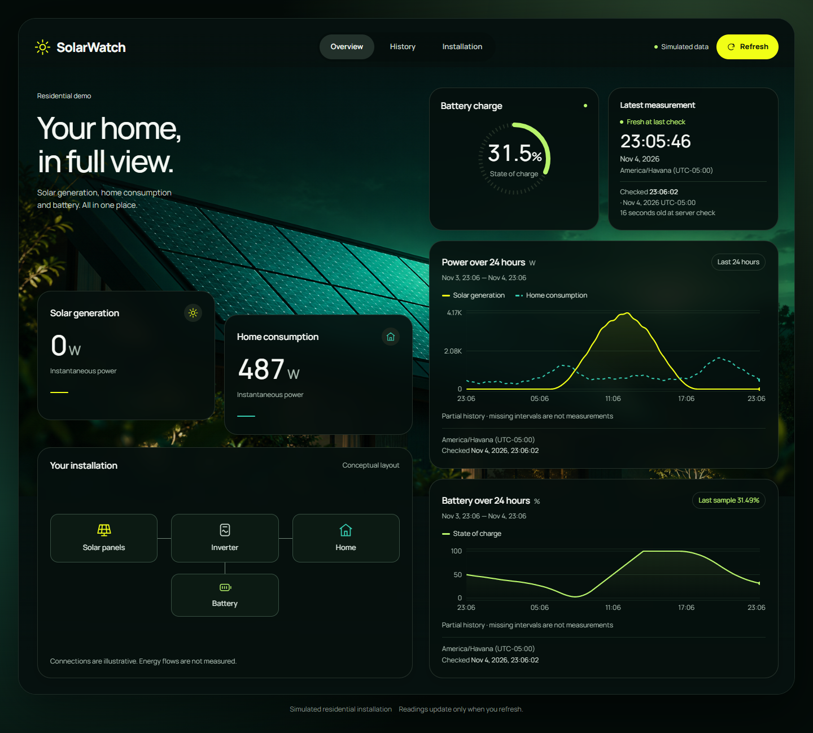
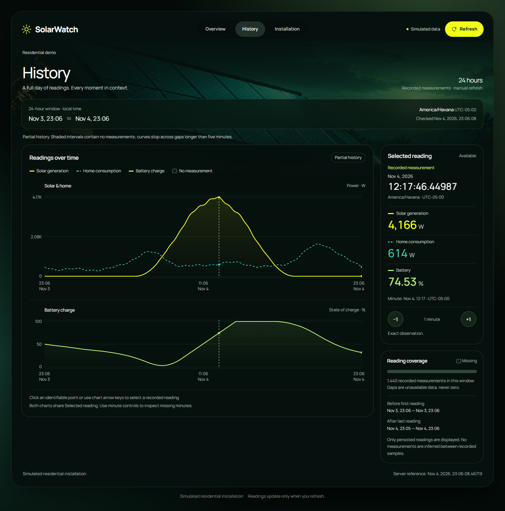
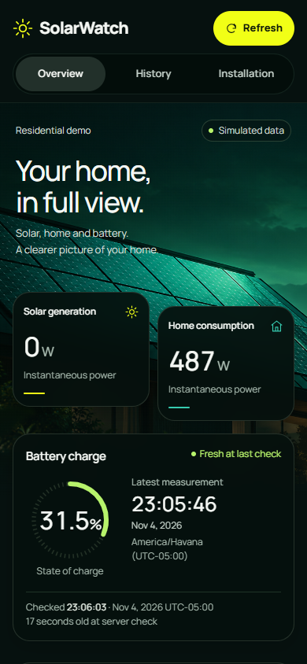
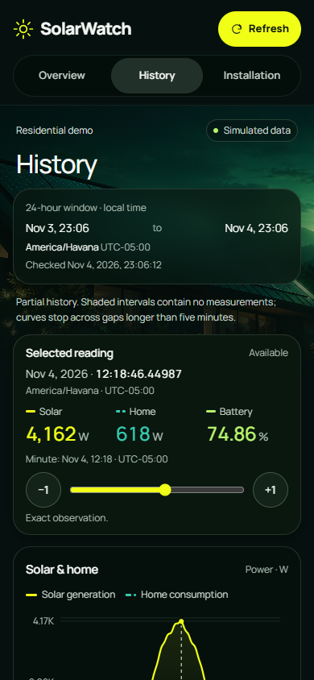

# Actual local demonstration captures

**Prepared for the owner's personal review under Issue #41; not yet approved as the final presentation.** These six PNGs are unedited captures of commit `b4a9c926648848361738f3ddeaddc104ed4aa2e5`, connected to real .NET/PostgreSQL through the existing Vite preview proxy. Every reading is simulated by `residential-v1`, seed 42; none is a frontend fixture. [Reproduce](README.md) · [Results and comparison](VALIDATION.md) · [Full provenance/hashes](manifest.json).

Chrome for Testing/Chromium 156.0.8078.4, DPR 1, `en-US`, `America/Havana` (UTC−05:00 at capture), reduced motion enabled. Desktop viewport: **1440 × 1186**; mobile emulation: **390 × 844**, with touch. Manrope loaded normally in all captures. No API/clock/font request replacement was used.

The server reference for generation was `2026-11-05T04:05:46.4498706+00:00`, normalized to `2026-11-05T04:05:46.449870+00:00`. The last simulated observation is at night: **0 W solar, 487 W consumption, 31.49% battery** (Overview displays 31.5%). Zero solar is a real persisted simulated value. All capture checks found the observation **18.39–27.51 seconds old by server `asOf`**, correctly fresh. Later views naturally become stale; dates were not falsified.

## Overview — desktop

Full page, 1440 × 1298. Night-time current metrics coexist with the real day/night history.

## History — desktop

Full page, 1440 × 1456. Shared exact observation: 12:17:46.44987 local, 4,166 W / 614 W / 74.53%. Both chart markers and the panel refer to the same persisted UTC row.

## Overview — mobile

Initial 390 × 844 viewport; the [complete 390 × 2001 view](captures/overview-mobile-full.png) includes both charts and installation details.

## History — mobile

Initial 390 × 844 viewport; the [complete 390 × 1758 view](captures/history-mobile-full.png) includes charts and touch controls. The selected exact row is 12:18:46.44987 local, 4,162 W / 618 W / 74.86%, following the mobile interaction sequence.

The supplied photograph retains its existing [publication authorization](../design/ASSETS.md). No Ekova image or font binaries were added. Browser emulation is not evidence of physical-mobile, native zoom or screen-reader behavior.
