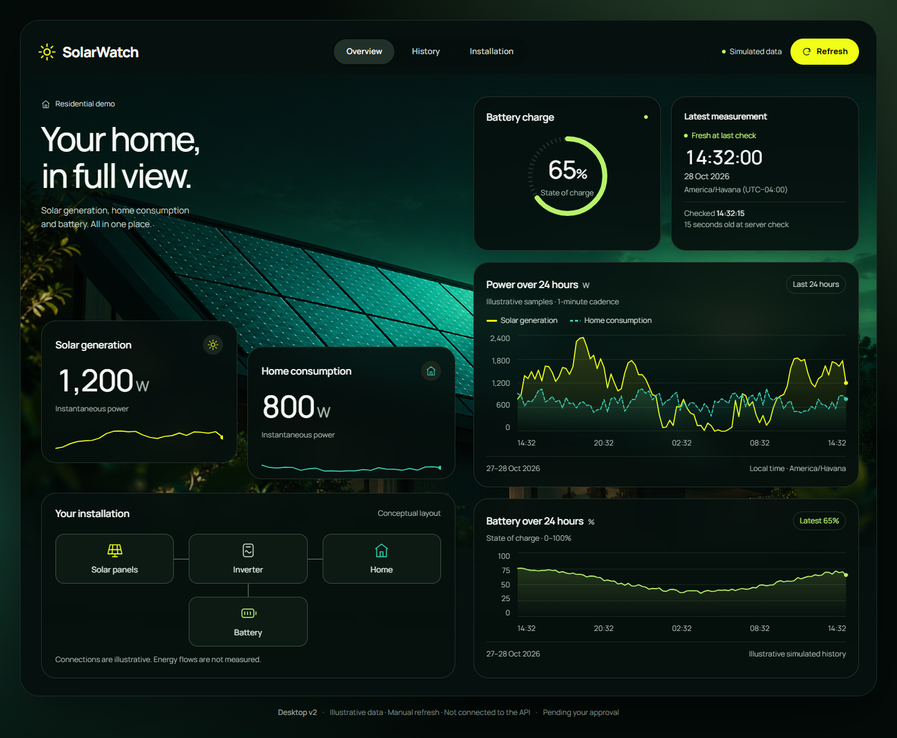

# Approved dashboard design handoff

This is **design evidence**, not the implemented React dashboard. [Issue #12](https://github.com/libanlsilva/solarwatch/issues/12) and Phase 4 remain open until the owner reviews and integrates the design PR. The MVP remains unfinished.

Read [DESIGN.md](DESIGN.md) for the small reusable system, [asset provenance](ASSETS.md) for publication permissions and [validation](VALIDATION.md) for checks and limitations.

## Approved references

The owner personally approved the following versions and requested no further visual revisions. The local originals remain untouched. Versioned exports below preserve the exact approved file bytes; `prototypes/manifest.json` records SHA-256 values. Original pending-review labels in frozen HTML, captures and state review notes are historical checkpoint text, superseded by this approval record. They are not the current project status.

| Reference | Editable HTML | Review image |
| --- | --- | --- |
| Overview Desktop v2 | [Prototype](prototypes/desktop-v2/index.html) | [1440px capture](prototypes/desktop-v2/solarwatch-desktop-02.png) |
| Overview Mobile v1 | [Prototype](prototypes/mobile-v1/index.html) | [Initial](prototypes/mobile-v1/solarwatch-mobile-01.png) / [complete](prototypes/mobile-v1/solarwatch-mobile-01-full.png) |
| History Desktop v1 | [Prototype](prototypes/history-desktop-v1/index.html) | [Reading](prototypes/history-desktop-v1/solarwatch-history-desktop-01.png) / [gap](prototypes/history-desktop-v1/solarwatch-history-desktop-01-gap.png) / [empty](prototypes/history-desktop-v1/solarwatch-history-desktop-01-empty.png) |
| History Mobile v1 | [Prototype](prototypes/history-mobile-v1/index.html) | [Initial](prototypes/history-mobile-v1/solarwatch-history-mobile-01.png) / [complete](prototypes/history-mobile-v1/solarwatch-history-mobile-01-full.png) / [touch selection](prototypes/history-mobile-v1/solarwatch-history-mobile-01-touch.png) / [gap](prototypes/history-mobile-v1/solarwatch-history-mobile-01-gap-full.png) / [empty](prototypes/history-mobile-v1/solarwatch-history-mobile-01-empty-full.png) |
| Interface States v1 | [Seven-state review gallery](prototypes/interface-states-v1/index.html) | [Gallery capture](prototypes/interface-states-v1/gallery-preview.png); all 24 paired examples are linked from the gallery |



The desktop capture is a prototype with illustrative readings. It is not a screenshot of a deployed or implemented dashboard.

## Reproduce and inspect

1. Clone the branch/PR and open the chosen `index.html` in a modern browser. Keep the folder structure: state specimens use relative `<base>` references to their approved Overview/History sources.
2. Use 1440px viewport width for desktop, 390×844 for the mobile capture, and 360/430px widths for narrow/wide mobile review. Dedicated mobile files intentionally stay phone-sized on a large review canvas.
3. Manrope is requested from Google Fonts; internet access is needed for that font. No font file is vendored. If unavailable, the declared Segoe UI/sans-serif fallback renders the design with potentially different wrapping. PNG captures preserve the reviewed appearance.
4. History review controls switch the fixed available/gap/empty fixtures. Mobile supports taps, keyboard-accessible minute controls and a range selector. The normal fixture selects 28 Oct 2026 08:12:00 local; the example zone is America/Havana (UTC−04:00 on these dates).
5. The state gallery links four specimen HTML files and 24 captures. Refresh/Retry only stages a request; resolve it with **Complete successfully** or **Fail preview** below the app surface. These are review controls, not product features. No API, backend, database or simulator needs to run.

Overview's frozen navigation uses in-page sections; the detailed History specimens link to Overview. These independently reviewed files are not a working router. Likewise, their Refresh button is not the functional application's data request. Do not copy prototype fixture scripts into production.

To repeat design checks using the repository's existing Playwright tooling:

```sh
cd frontend
npm ci
npx playwright install --no-shell chromium
cd ..
node docs/design/checks/verify-prototypes.cjs
```

No dependency manifest changes are required. The check reads the approved exports without rewriting them and puts its report under ignored `artifacts/design-review/`. Existing application CI is separate; the design checker is a documented local verification, not an added workflow.

## Handoff boundaries

The package contains approved HTML/CSS/SVG fixture sources, the owner-authorized photo and review PNGs, state specimens, the measured short-phone observation and a portable hash manifest. Intermediate Desktop v1, Ekova references, raw Stitch output, private tool metadata, local paths and obsolete review payloads are excluded.

The local corrected exports are authoritative. The earlier exploratory Stitch screen does not mirror them. No private tool access is needed to reproduce the included design.

The seven state treatments are approved, including per-resource loading/empty/error/retry, stale latest readings, refreshing, retained data and partial history. The final system document and publication packaging are submitted for PR review. No React components, UI/chart libraries, historical API, backend or simulator changes are part of this delivery. After review and squash integration, close Phase 4 and prepare a separate Phase 5 issue; do not start dashboard implementation automatically.
