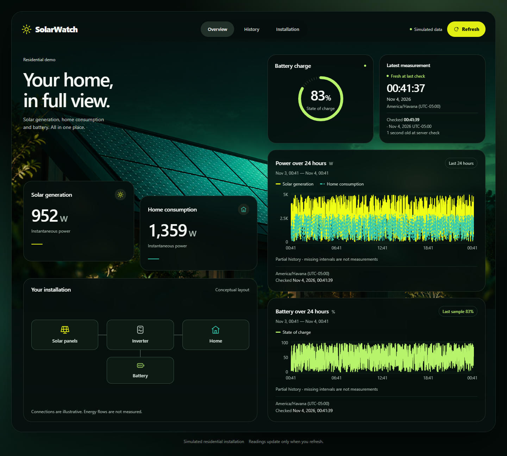

# Clean-clone local setup verification

**Issue #34 — Phase 6, delivery A; 2026-11-04.** The owner personally approved this evidence and [PR #35](https://github.com/libanlsilva/solarwatch/pull/35). Delivery A is complete through its squash integration (`23f9638`), closing Issue #34. It verifies the existing host-run API/React + PostgreSQL Compose path and does not complete Phase 6 or the MVP. No product code, dependencies, contracts, tests, simulator patterns or ingestion guards changed.

Follow the [reproducible PowerShell walkthrough](../development/CLEAN_CLONE.md). The [portable evidence](evidence/clean-clone.json) contains original clone hashes, step exits/timings, timestamps, actual HTTP/SQL outcomes, repeat/persistence comparisons and browser results. Its simulated data and non-secret metadata are deliberately retained; populated configuration, private machine paths and unrelated Docker resource names are excluded.

## Starting conditions and configuration

Two actual `git clone --depth 1 --branch main` operations fetched GitHub main at **`dbae20671ac0a7831733c6f6ef6943b9938fa099`**. Neither was a worktree or a copied checkout. Both started with clean Git status and without `.env`, API `bin/obj`, `frontend/node_modules` or `frontend/dist`; both remained Git-clean after setup.

Each run used a newly generated password, ignored `.env`, unique Compose project/named volume and unused loopback ports. New per-run `USERPROFILE`, `APPDATA`, `LOCALAPPDATA` and `DOTNET_CLI_HOME` directories had no user secrets. Child shells cleared inherited app configuration prefixes, supplied explicit Development/connection/URL values, used empty npm user/global configuration and an explicit public-only NuGet configuration. Installed toolchains and ordinary NuGet/npm/Playwright/image caches were reused as allowed by the issue. These were clean application setups on an existing Windows machine, **not fresh OS installations or cache-free runs**.

| Verified tool | Version |
| --- | --- |
| Windows | 10.0.26300.0 |
| .NET SDK | 10.0.300 |
| Node.js / `npm.cmd` | 24.15.0 / 11.12.1 |
| Git | 2.53.0.windows.3 |
| Docker / Compose | 29.5.2 / v5.1.4 |
| PostgreSQL | 17.11 |
| Playwright Chromium | 156.0.8078.4 |

| Run | Compose project / volume prefix | PostgreSQL | API | React preview |
| --- | --- | --- | --- | --- |
| A | `solarwatch-phase6-a-20261104` | 5544 | 5271 | 5273 |
| B | `solarwatch-phase6-b-20261104` | 5545 | 5272 | 5274 |

Docker Desktop was initially stopped and was started explicitly. The two new volume names did not exist before setup. Existing stopped databases were never reused or queried. A final resource comparison confirmed all **six** pre-existing container identities/states and **35** pre-existing volume names unchanged; this is resource-isolation evidence, not a claim to have audited their contents.

## Executed checks and outcomes

| Check | Evidence / actual result |
| --- | --- |
| Install/build on A and B | Scoped `compose up -d --wait`, public-feed `dotnet restore`, Release build, existing `migrate` CLI, `npm.cmd ci`, lint, build and frontend units all exited 0. Both .NET builds reported zero warnings/errors. |
| Explicit connection required | With the fresh profile and connection removed, the migration command failed with the expected `Configure ConnectionStrings:SolarWatch` error. It did not silently use local user secrets. |
| Empty migrated database | Latest returned 200 with `reading: null`; History returned 200 with `readings: []` and UTC window metadata. Retained response bodies come from an additional fresh migrated `solarwatch_empty` database inside B, queried by a temporary API on 5275; no populated demo was cleared. |
| Fresh seed and controlled repeat | Both current-time seeds produced 1,200 W / 800 W / 65%. Repeating each exact returned timestamp reported the same available reading without duplication. |
| Complete simulated history | Each unchanged `--history-24h --seed 42` run accepted exactly **1,441** rows with no rejection/error/uncertainty. All accepted timestamps were checked: inclusive 24 hours, exactly 60 seconds apart. The CLI received that run's API `asOf`; the retained final CLI instant is its microsecond-normalized reference, not the unrecorded original `asOf` string. |
| Reproducibility / rerun | Both seeded metric sequences have the same SHA-256 despite different reference instants. A confirmed identical rerun in each environment exited **1**, reported **1,441 HTTP 409 conflicts**, zero accepted/errors/uncertain/unattempted, and left SQL row count/content digest unchanged. No overwrite/reset occurred. |
| Real connected UI | A production build served by Vite preview used its real proxy, .NET API and isolated PostgreSQL. Overview metrics matched the response; History showed persisted readings and Installation was reachable. The smoke used no API mocks. |
| Manual Refresh | A further finite simulator sample (`--count 1 --seed 43`) was accepted in each run. React retained its prior snapshot until Refresh, then matched the newly persisted **952 W / 1,359 W / 83%** reading. Exactly two Latest and two History page requests were observed across initial load/Refresh/navigation; no browser JS errors. |
| Local ingestion guard | A POST with a forwarded header returned **403**. All existing environment/local-origin/validation/concurrency tests stayed active; no guard was relaxed. |
| B normal restart | API/frontend Ctrl+C observed, frontend batch termination confirmed, listening ports closed; scoped Compose `stop` / `up --wait`, then app restart and browser reload succeeded. |
| A container recreation | Same host shutdown; scoped Compose `down` **without `-v`** retained its volume. `up --wait` created a different container, then app restart and browser reload succeeded. |
| Persistence | Both restart paths retained **1,443** demo rows (seed + history + manual-refresh sample), identical ordered SQL content digests and the same Latest reading. Server `asOf` advanced. React reload selected/displayed that persisted reading again. |
| Final cleanup | Both task app stacks and Compose containers/networks stopped/removed; no task listeners remained. Only their two named volumes and ignored local configuration were retained for inspection/restart. No `down -v`, prune or implicit reset was run. |

The confirmed repeat took 40.337 s on A and 40.527 s on B; first-load timing is recorded in the portable evidence. These local observations are not benchmarks or guarantees. A Windows PowerShell diagnostic collector stalled after the original CLI operations; it was stopped and the SQL/HTTP/CLI comparisons were re-collected with Node. That collector is not represented as a passing command.

**Persisted rows are not a later live-window count.** At the captured Refresh, History returned 1,440 rows; after the longer test/restart sequence A returned 1,422 and B 1,432. The lower bound moves with the server reference, so old rows naturally leave a fresh query. SQL still contained 1,443 rows. The browser's partial-coverage notice, edge gaps and dense independent random patterns are expected representations of these unchanged simulated readings.

## Existing automated suite

All **252 unique cases passed, zero failed/skipped**, from clone A; none were added or removed. The test shell cleared the demo connection and used dedicated `solarwatch_a_tests` / `solarwatch_a_e2e` databases on A's isolated PostgreSQL instance. The E2E suite's deliberate HTTP/error simulations remain test cases, distinct from the no-mock connected smoke above.

| Command | Result |
| --- | --- |
| `dotnet test backend/src/SolarWatch.slnx -c Release --no-build --no-restore` | 116 unit + 56 real PostgreSQL integration tests; reported durations 8 s / 2 m 59 s |
| `npm.cmd run test:unit` (frontend) | 46 cases; also repeated on B, not counted twice |
| `npm.cmd run test:e2e` (frontend) | 34 Chromium Full Stack cases, 7.7 min locally |

Release build preceded `--no-build`; frontend build and browser installation preceded E2E. The existing Backend CI, Frontend CI and Full Stack E2E workflows are unchanged and discover these same tests; final PR check results are reported on GitHub, separately from the local run.

## Actual connected captures and limits

[Overview desktop, 1440 px](screenshots/clean-clone-overview.png) · [History mobile, 390 px, full page](screenshots/clean-clone-history-mobile.png)

Captures were inspected after the accepted finite sample and Refresh on A. They are application screenshots, not modified prototypes or frontend fixtures. External Google-font requests were blocked for deterministic capture; the declared fallback rendered. Dense curves reflect the existing generator, whose improvement remains separate. This delivery does not repeat Phase 5's design/accessibility audit.

Only Windows/PowerShell was exercised here. Native browser zoom, Narrator/NVDA and physical mobile remain **unverified**, under the existing [limited Phase 5 acceptance](PHASE5_ACCEPTANCE.md) and [manual checklist](WINDOWS_MANUAL_CHECKS.md). No new accessibility, cross-platform or production-readiness claim is made.

The [full-stack Compose evaluation](../architecture/local-compose-evaluation.md) inspects the existing API build context and proposes a separately reviewed follow-up. No API Docker image build, frontend container or full-container runtime was implemented/verified. Phase 6, the final release demonstration and MVP completion still require their own review and evidence.
