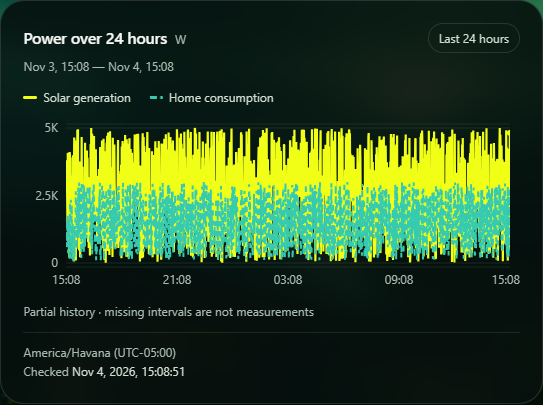
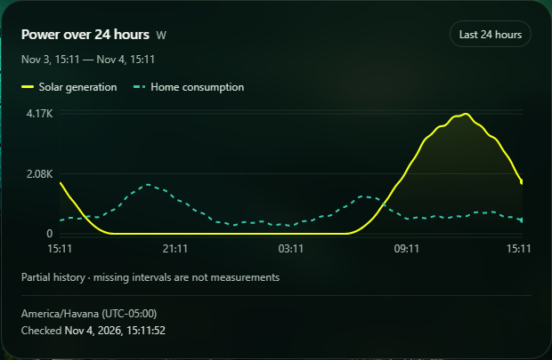
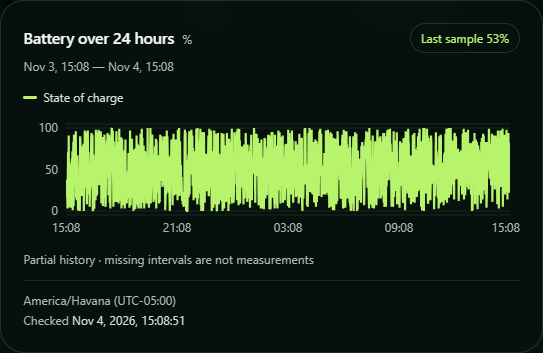
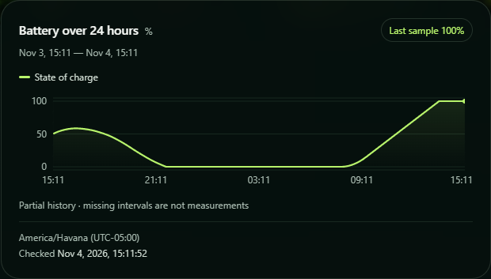

# Residential profile validation

Issue #38, dedicated branch from `14b3504` after personally approved PR #39 integration and three passing main workflows. ADR-001 is accepted: PostgreSQL remains in Compose, .NET/React on the host. This profile delivery awaits personal PR review; Phase 6/MVP and definitive demonstration remain pending.

The [model specification](../architecture/residential-history-profile.md) was committed as `4b45635` **before implementation**. Production changes are confined to the simulator: one pure generator, explicit history-only CLI selection and routing through the existing HTTP runner. Backend/API/EF/migrations, frontend application/charts, dependencies, Compose/Dockerfile and local-ingestion security are unchanged. Original random generation and finite/continuous runners are untouched.

## Evidence and scope

| Requirement | Verification |
| --- | --- |
| Reproducibility/version | Unit fixture pins SHA-256 of all 1,441 canonical rows for a fixed seed/reference; repeated calls, UTC-equivalent offsets and sub-microsecond normalization agree. See [controlled comparison and canonical format](RESIDENTIAL_COMPARISON.md). |
| UTC boundaries/cadence | Every expected timestamp compared, including inclusive endpoints, seconds/microseconds and a DST-change date; no local-clock sampling. Actual CLI test passes the original server `asOf` string without JavaScript millisecond truncation. |
| Pattern semantics | Night zeros, daytime peak/ramp, variable base/activity demand, adjacent power/charge bounds and circular midnight behavior tested, with seed extremes and distinct seed variation. |
| Battery | Initial 50%, fixed 10 kWh assumption, ±2 kW rate, rounded-output precision, charge/discharge direction, gradual updates and 0/100 saturation tested. No measured energy/flow is exposed. |
| Compatibility | All 252 baseline cases preserved. Omitted profile stays null in all legacy modes; malformed/unknown/duplicate/incompatible profile arguments reject clearly. Existing random generator/finite/continuous code is unchanged. |
| Real PostgreSQL | One new complete HTTP run encounters a deliberately occupied key: 1,440 accepted + 1 HTTP 409, non-success exit, all 1,441 persisted values checked including unchanged old data; Latest and History response values checked. |
| Interrupted persistence | A short run commits three rows but loses the third acknowledgment: 2 accepted, 1 uncertain, 1,438 unattempted, exit 1. Actual PostgreSQL rows match the first three model samples. Unit cases also cover confirmed cancellation and HTTP failure without retries. |
| Full Stack | Actual CLI → existing local API → dedicated PostgreSQL → React, no API mocks. All returned rows compared with CLI acknowledgments; all three SVG curves checked vertex-by-vertex for value/time geometry and common power scale. Dense charts intentionally retain only the final marker. Refresh and History's Selected Reading verified. |
| Runtime/volume isolation | A new uniquely named Compose project/volume on loopback port 5546, generated ignored credentials and separate `_tests` / `_e2e` databases. No existing demo database is read, reset or overwritten. |

Unit model cases run in memory. Only **one new 1,441-attempt run per integration/browser layer** is added to CI; interruption is three writes. Existing random full-series tests remain active and supply random comparison images without another large setup. No bulk endpoint or model-specific persistence path was added.

After local validation, only the task's scoped Compose containers/network were removed with `down` without `-v`; its named volume/configuration were retained. Test API/frontend listeners stopped. No existing database or volume was cleared.

## Local commands and results

Restore/Release build (zero warnings/errors), frontend lint/production build and the existing frontend units passed. Backend testing used the explicitly scoped `SOLARWATCH_TEST_CONNECTION`; Playwright used `SOLARWATCH_E2E_CONNECTION` with its existing ports 5181/4181. Generated credentials stay in ignored configuration/environment, never simulator arguments or public evidence.

- `dotnet restore backend/src/SolarWatch.slnx`
- `dotnet build backend/src/SolarWatch.slnx --configuration Release --no-restore`
- `dotnet test backend/src/SolarWatch.slnx --configuration Release --no-build --no-restore`: **138 unit + 58 real PostgreSQL integration**, zero skipped; integration reported 1 min 16 s locally.
- In `frontend`: `npm.cmd run lint`, `npm.cmd run build`, `npm.cmd run test:unit`: **46 unit cases**, zero skipped.
- `npm.cmd run test:e2e`: **35 Playwright cases passed in 6.9 min**, zero skipped. Total: **277 cases**, preserving all 252 baseline cases and adding 22 unit + 2 integration + 1 E2E cases.

An early new E2E assertion assumed every dense sample had a visible dot; the test was corrected to inspect actual path vertices without changing the UI. Its per-vertex trace assertions were then aggregated while still checking every vertex, reducing the focused journey from 2.3 min to 18.1 s in the final complete run. A legacy first-case fixture POST exceeded its unchanged 30-second test budget once; an isolated unchanged repeat passed in 10.7 s, followed by the full 35-case pass. No global timeout/retry was widened and no product change was made for that local timing observation. CI results are reported on the PR's final head separately from local timings; local timings are not benchmarks.

## Actual technical comparisons

These cards were captured from existing React graphs with real persisted simulated data, **not definitive portfolio screenshots**. Both use seed 42; their live server references and responsive widths differ, so use the [fixed-reference table/digests](RESIDENTIAL_COMPARISON.md) for exact quantitative comparisons. The displayed axes/rounding are the existing UI; small uncovered window edges are expected as `asOf` advances after generation.

| Existing random | residential-v1 |
| --- | --- |
|  |  |
|  |  |

The existing font fixture bounds external-font waits and can use the declared fallback. No approved design or historical evidence image was modified. Native zoom/Narrator/NVDA/physical-mobile checks remain unverified under the [limited Phase 5 acceptance](PHASE5_ACCEPTANCE.md).

The solar/activity schedule is fictional and fixed in UTC. Charge is lossless, restarts at 50% per requested window and ignores saturation surplus/shortfall. Overlapping windows need not agree on battery charge. Stored charge has two decimals; Overview keeps its existing one-decimal presentation. See the [isolated empty-demo recipe](../architecture/residential-history-profile.md#prepare-an-isolated-empty-demonstration) before changing profiles: 409 never means an old row was replaced or verified to have the requested new values. No production-readiness, final demonstration or release claim is made.
